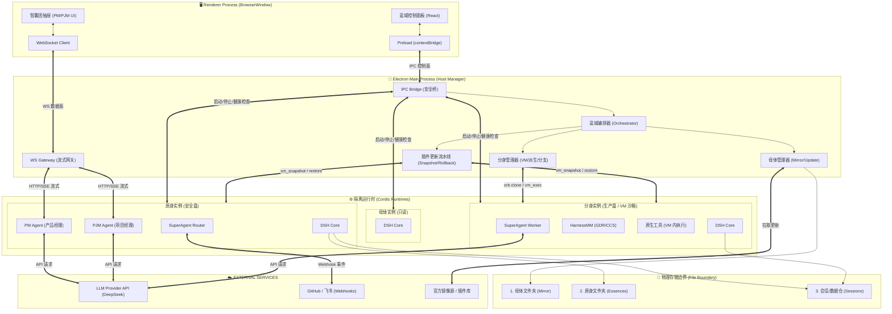
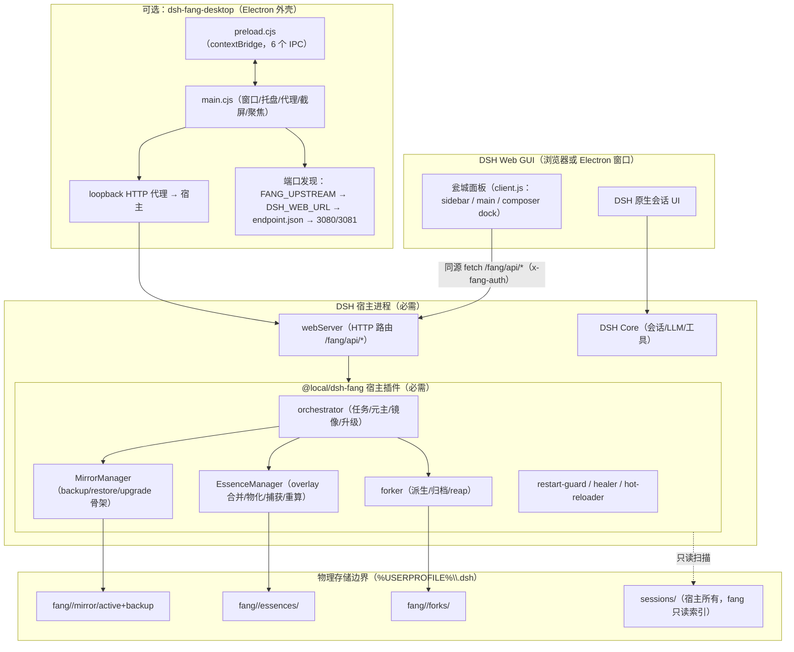

# 架构：DSH-Fang PC 客户端（核心架构 v1 · 对齐版）

> 输入：用户提供的《DSH-Fang PC客户端核心架构设计》Mermaid 图。
> 本文做三件事：①原样收录目标架构；②给出**当前真实实现**架构；③裁定边界与分阶段落地，
> 避免把「设计里想要」写成「现在已经具备」。
>
> 硬约束（沿用既有决策）：
> **`@local/dsh-fang` 插件必须能独立完整使用，PC 客户端只是可选的外壳。**

## 1. 目标架构（用户设计，原样收录）

## 2. 当前真实架构（v3.0.8 / v3.0.9-dev）

## 3. 差异对照（目标 vs 现在）

| 目标图中的节点 | 现状 | 结论 |
|---|---|---|
| Renderer：瓮城控制面板 (React) | 面板是 **Web 客户端半**（`client.js`），Electron 只是把它装进窗口 | 保留：一套 UI，两处可用 |
| Preload / IPC Bridge | ✅ `preload.cjs` 6 个方法：openExternal / close / desktopInfo / revealToken / focusMother / captureScreen | 已具备 |
| WS Gateway / WS Client | ❌ 未实现；面板走 HTTP + DSH 原生传输 | 暂不引入：多一套 WS 会重复 DSH 的流式通道 |
| Orchestrator | ✅ 在**宿主插件**里（`src/plugins/orchestrator.mjs`） | **不搬到 Electron main**（否则 Web-only 用户失去编排能力） |
| MirrorMgr / DerivedMgr / PluginUpdater | ✅/◐ 在宿主插件：mirror + forker + essence；PluginUpdater 只有「元主同步」没有「插件更新」 | 归位宿主插件；Electron 只做壳 |
| 母体/原身/分身实例运行态 | 母体=宿主进程；分身=独立 dsh 进程（18000 等）；**原身没有运行态** | 原身运行态是缺口（配置态 Web） |
| PM/PJM、SuperAgent Router/Worker、HarnessMM | ❌ 无 | 属于上层业务，不在本仓 |
| vm_snapshot / orb clone / vm_exec / vm_restore | ❌ 全仓 0 处 | 需要外部 provider，先做目录级快照 |
| 存储边界 3 目录 | ✅ mirror / essences / forks / sessions（多一个 forks） | 已对齐 |

**边界裁定（重要）**：图中把 Orchestrator / MirrorMgr / DerivedMgr 放进 Electron main，会把「PC 客户端」变成必需组件，违背既定约束。正确切分是：

- **宿主插件** = 大脑（编排、镜像、元主、分身、升级）；
- **Electron 外壳** = 窗口 + 端口发现 + 本机能力（截屏/聚焦/外链），可随时缺失；
- **VM 能力** = provider 插件，经 `commercial` 钩子注入，缺失时降级为目录快照。

## 4. 接口契约

### 4.1 Electron IPC（现有）

| 方法 | 用途 | 失败语义 |
|---|---|---|
| `openExternal(url)` | 打开宿主/门户 | 仅 http(s)，拒绝其他协议 |
| `close()` | 关闭窗口 | — |
| `desktopInfo()` | `{upstream, appVersion, endpointSource}` | 发现失败返回 `upstream:''` |
| `revealToken()` | 返回 fang 安装令牌（主进程持有） | 不落盘、不回显日志 |
| `focusMother()` | 聚焦 DSH 窗口 | 失败静默 |
| `captureScreen()` | 主进程截屏 → 剪贴板 | 失败返回 `{ok:false}` |

### 4.2 宿主 HTTP（对面板）

- `GET /fang/api/status`、`GET /fang/api/upgrade/status`（含 `light`）
- `POST /fang/api/mirror/clone-profile`、`POST /fang/api/essence/sync`
- 鉴权：`x-fang-auth` + loopback Host/Origin；写操作 JSON content-type。

### 4.3 端口发现（Electron）

`FANG_UPSTREAM` → `DSH_WEB_URL` → `<dataDir>/endpoint.json` → 3080/3081 探测；
只接受 `GET /fang/api/status` 返回 **HTTP 200** 的候选（4xx 视为非 fang 宿主）。

## 5. 分阶段落地

### D1（已完成 / 小补强）

- [x] 端口发现 + 单飞 token 刷新 + 代理拒绝绝对 URL
- [x] 系统截屏 / 聚焦母体 / 托盘行为
- [x] 状态灯（绿/黄/红）数据源：`upgrade/status.light`
- [ ] 桌面壳健康检查上报（把 `endpointSource` 暴露到面板「连接信息」）

### D2（下一步，不依赖 VM）

1. **插件更新流水线（目录级）**：元主 merged/profile 快照 → 更新 → 健康检查 → 失败回填；
2. 快照位置 `essences/<id>/snapshots/<ts>`，审计写 `AUDIT`；
3. 面板 `E-04`「更新插件」+ 黄/红灯提示（大版本跨越）。

### D3（需要原身运行态）

1. `essence.start()`：用 merged/profile 起配置态 Web 实例（禁 sessions）；
2. `pnpm update` / `dsh plugin update` 在该实例目录执行；
3. 健康检查：实例 `/api/status` + compat gate + 存活 N 秒。

### D4（需要 provider）

1. `snapshotProvider` 接口：`snapshot / restore / exec / job / audit`；
2. 经 `ctx.get('fangCommercial')` 注入（w2m 或其他 VM 提供方）；
3. 无 provider：UI 只显示「目录快照」，不显示「VM 快照」。

## 6. 验收

- D2：元主更新失败后 `merged/profile` 与 `overlay` 完全回填，面板红灯 + 快照 id；
- D3：原身实例能起停，且 `/fang/api/status` 健康检查通过；
- D4：接入 provider 后同一流程切换为 VM 快照，未接时行为不变。

## 7. 风险

| 风险 | 处理 |
|---|---|
| 把编排搬进 Electron → Web-only 用户残废 | 架构上禁止；Electron 只调接口 |
| 没有 VM 却宣称 VM 回滚 | 文案分层：目录快照 / VM 快照，未接 provider 不显示后者 |
| 原身运行态泄漏 sessions | 启动参数禁用 sessions 根（DECISIONS v3.0.8 #4） |
| 多实例端口冲突 | 端口从池分配 + endpoint.json 落盘 + 健康检查 |
